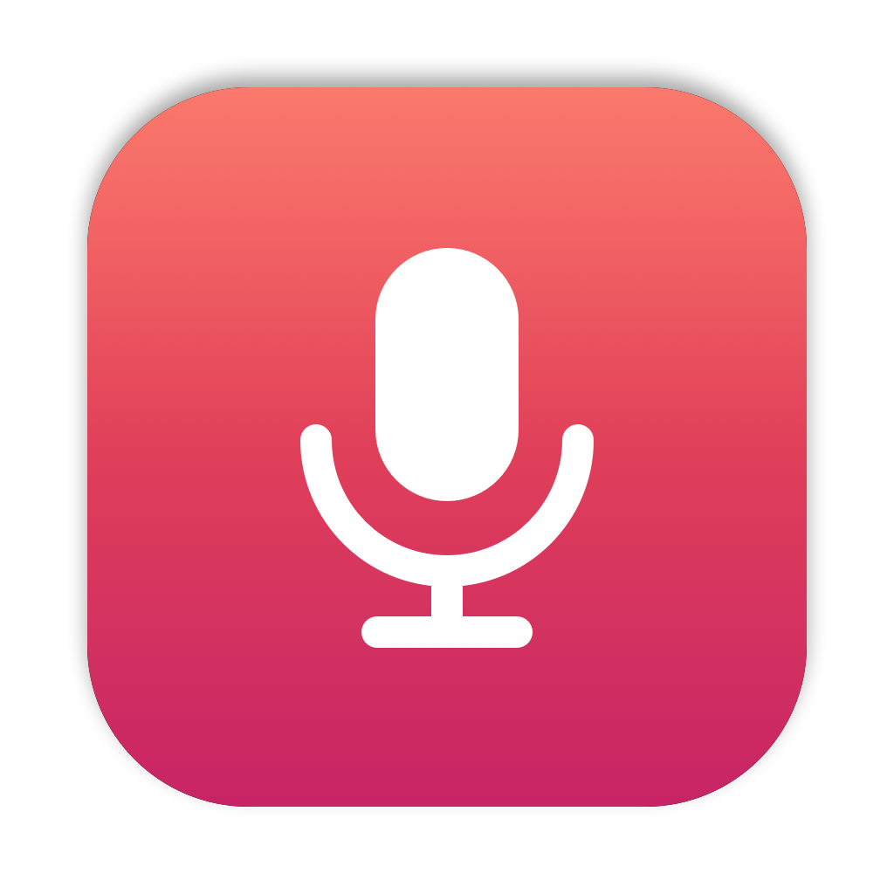

# MicHold



A small macOS app for hold-to-dictate. Hold the microphone key (the Dictation key, same physical key as F5) or the space bar: it records while you hold, transcribes with [whisper.cpp](https://github.com/ggml-org/whisper.cpp) when you release, and pastes the text at the cursor. A short press of the microphone key opens Siri. It has no window and no menu bar icon.

## Behavior

| Action | Result |
|---|---|
| Hold the microphone key for 0.3 s, or the space bar for 0.5 s | Recording starts (Tink sound). whisper-server is launched at this point |
| Release | Recording stops (Pop sound), the audio is transcribed and pasted, and whisper-server is stopped |
| Short press of the microphone key | Opens Siri |
| Empty result | Basso sound |

- Transcription stays on your machine. Audio is only sent to whisper-server on `127.0.0.1`.
- With the space bar, the first space is typed as usual and removed with Backspace once recording starts. Holding space to insert many spaces no longer works. Space pressed together with Shift, Control, Option or Command is passed through unchanged.
- Whisper returns one line per phrase. The lines are joined into one with "、" (spaces for languages other than ja/zh) so the pasted text stays on a single line, which terminals and chat inputs do not collapse.
- Long recordings are split at the first pause after 20 s (at 45 s at the latest). Each piece is transcribed and pasted as soon as it is ready, so there is no length limit and you can see the text arrive while you keep holding. Pieces that stay silent are skipped.
- Pasting goes through the clipboard: it sends Cmd+V and restores the previous clipboard contents after 0.5 s.
- Log file: `~/Library/Logs/MicHold.log`

## Requirements

1. **whisper-server**, built from whisper.cpp:

   ```sh
   git clone https://github.com/ggml-org/whisper.cpp
   cd whisper.cpp
   cmake -B build && cmake --build build --config Release
   # produces build/bin/whisper-server
   ```

2. **A model** in ggml format from [ggerganov/whisper.cpp on Hugging Face](https://huggingface.co/ggerganov/whisper.cpp/tree/main). `ggml-large-v3-turbo-q5_0.bin` (about 574 MB) is a good balance of size and accuracy:

   ```sh
   mkdir -p ~/.local/share/whisper
   curl -L -o ~/.local/share/whisper/ggml-large-v3-turbo-q5_0.bin \
     https://huggingface.co/ggerganov/whisper.cpp/resolve/main/ggml-large-v3-turbo-q5_0.bin
   ```

   Put it anywhere you like and point to it from the config file below.

## Configuration

`~/.config/michold/config.json`

```json
{
  "serverBin": "/path/to/whisper.cpp/build/bin/whisper-server",
  "model": "/Users/you/.local/share/whisper/ggml-large-v3-turbo-q5_0.bin",
  "language": "ja",
  "triggers": ["micKey", "space"],
  "spaceHoldSeconds": 0.5
}
```

`triggers` and `spaceHoldSeconds` are optional and default to the values above. Use `"triggers": ["micKey"]` to disable the space bar trigger.

## Build and run

```sh
./build.sh                    # builds /Applications/MicHold.app, including the icon
open /Applications/MicHold.app
pkill -x MicHold              # stop it
```

The icon is drawn by `make-icon.swift`. To regenerate it:

```sh
swiftc make-icon.swift -o make-icon
mkdir MicHold.iconset && ./make-icon MicHold.iconset
iconutil -c icns MicHold.iconset -o MicHold.icns
```

## Privacy and security settings

On first launch, grant these three permissions in System Settings → Privacy & Security:

- **Accessibility**: to receive key events and to send the paste (Cmd+V)
- **Input Monitoring**: to detect key presses and releases
- **Microphone**: to record audio

If macOS asks you to "Quit & Reopen" after you grant a permission, do so. Rebuilding with `build.sh` changes the code signature, so you need to grant the permissions again.

If keys do not reach the app, check whether another app has secure input enabled (for example a password field). While it is on, macOS does not deliver key presses and releases to other apps.

Do not run it together with other apps that use the same key (for example OpenSuperWhisper).

## License

MIT
